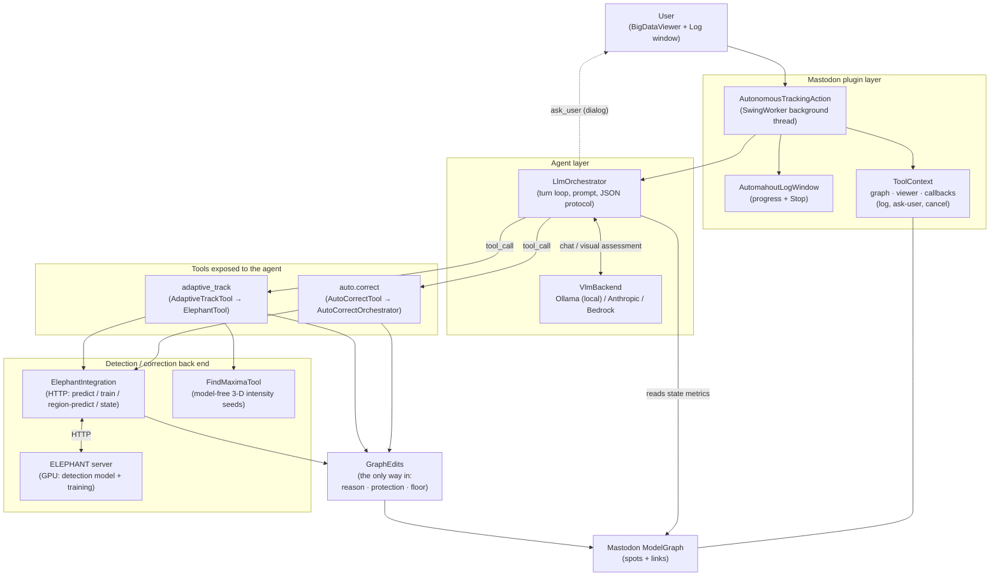
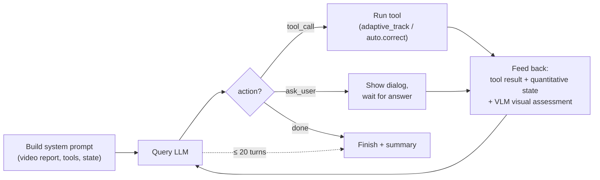
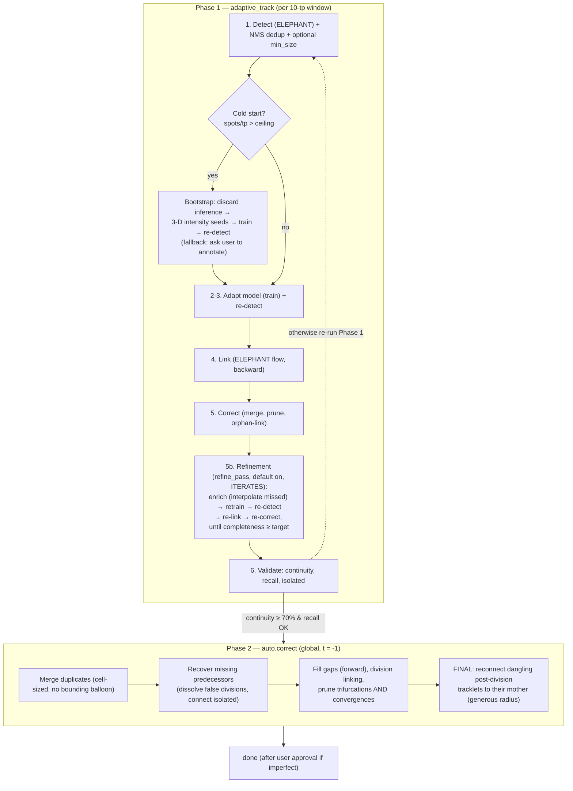

# mastodon-automahout — Architecture & Evaluation Metrics

`mastodon-automahout` drives **autonomous cell tracking** by wrapping
[Mastodon](https://github.com/mastodon-sc/mastodon) and the
[ELEPHANT](https://github.com/elephant-track) deep-learning server behind an LLM agent. The agent
detects, tracks, trains, corrects, and self-evaluates the result, escalating to the human only when
it cannot proceed on its own.

This document describes (1) the overall component structure and (2) the internal evaluation metrics
and how they are used.

---

## 1. Overall structure

### 1.1 Components

Key points:

- **Only two tools are exposed to the agent**: `adaptive_track` (the full integrated
  detection→train→link→correct→validate pipeline) and `auto.correct` (global topology cleanup).
  `adaptive_track` is a thin wrapper that always runs the adaptive pipeline, so a weak model cannot
  accidentally select a degenerate mode. Fine-grained manual tools (`spot.add`, `link.edit`, …) exist
  in the registry but are **not** exposed to the agent.
- The agent talks to an LLM through `VlmBackend` (local **Ollama** or **Anthropic**). After every
  action it also asks a vision model to assess BigDataViewer snapshots.
- `ToolContext` is the shared handle to the Mastodon `ModelGraph` and viewer, plus callbacks for
  logging, cancellation, and **asking the user** (human-in-the-loop).
- **Nothing writes to the graph directly.** Every deletion and every creation goes through
  `GraphEdits`, which requires the caller to say why and applies the protection and cell-count rules
  there rather than at each site (§1.4).
- Detection and training happen on the **ELEPHANT server** via `ElephantIntegration`
  (`/seg/predict`, `/seg/train`, region prediction, `/state/process`).

### 1.2 Agent loop

| Action | Meaning |
|---|---|
| `tool_call` | Run `adaptive_track` or `auto.correct` with parameters. |
| `ask_user` | Human-in-the-loop: ask a question (optionally with choices); the answer is fed back. Returns "no answer" in headless runs so the agent proceeds autonomously. |
| `done` | Declare completion with a summary. Allowed **only** when quality criteria are met (see §2). |

### 1.3 Tracking pipeline

The agent works in two phases; Phase 1 (`adaptive_track`) runs a per-window pipeline.

### 1.4 Every graph change goes through one place

`tool/GraphEdits.java` is the only code in the project that deletes a spot, creates one, or adds a
link. Nothing else calls `graph.remove`, `graph.addVertex` or `graph.addEdge`, and
`GraphEditsChokepointTest` fails the build if anything starts to.

It exists because of a measured failure mode rather than a preference for tidiness. A safety rule —
never delete a spot the user confirmed, never take a timepoint below the count they stated — used to
be hand-applied at each of ~40 mutation sites across two 7000-line files, and the sites it was not
applied to kept violating it silently, each recurrence costing a real run on real data to notice.
Before the chokepoint, protection reached 35 of 41 sites and the cell-count floor reached 3.

**Why a reason is required.** A bare `graph.remove(spot)` cannot be judged, because the correct rule
depends on why the spot is going:

| `Reason` | Meaning | Floor applies |
|---|---|---|
| `PROBABLY_NOT_A_CELL` | a statistical call: contrast against a sampled baseline, a size or shape threshold, a track too short, a sandwiched phantom | **yes** |
| `NOT_A_CELL` | a direct measurement: no signal at all, a centre outside the imaged volume | no |
| `DUPLICATE` | a second detection on a cell that is still there | no |
| `TOPOLOGY` | track surgery — pruning a link, dissolving a false division, filling a gap | no |
| `TRAINING` | a spot created or deleted as a training annotation: an fp negative, a cold-start seed, a restored GT store | no |
| `BULK` | wholesale reset of a timepoint or window | no |
| `USER` | an explicit human action through a manual tool; no automatic guard applies | no |

The floor's axis is **confidence, not cause** (§2.2). Deleting a detection that is *probably* not a
cell rests on an estimate weaker than the count the user gave, so where the two disagree the user's
number wins; deleting one that carries no signal at all does not, and bounding a certainty by an
approximation was observed protecting detections reading literally zero intensity while refusing 189
deletions in one window.

**What is enforced.** Protection, for every reason but `USER` — a confirmed spot is never deleted, and
a new spot is never left sitting on top of one. The floor, for `PROBABLY_NOT_A_CELL`. `addSpot`
returns `null` when it withdraws a spot, so callers decide what to do about a refusal rather than
discovering one later. A per-run tally reports what each reason accounted for, and counts what the
floor kept apart from what protection kept, so a run can say which guard held.

Counting the spots at a timepoint is a pass over every vertex, so the count is memoised for the
timepoint a deleting pass is working on and maintained as spots come and go — once per pass per
timepoint rather than once per spot. That memo is only sound because everything goes through this
class; it re-seeds when the timepoint changes, which bounds drift from an edit made elsewhere to the
pass currently running.

### 1.5 Running the correction passes without a microscope

`ToolContext.forReplay(Model)` backs a context with a bare `Model`: no project, no viewer, no image
data, no ELEPHANT server. 23 of `AutoCorrectOrchestrator`'s public passes need no pixels, including
`runTopologyConsistency` and `globalCleanup` — which is where the confirmed bugs lived.
`requireViewer()` still throws there deliberately: a pass that samples intensity is not replayable off
a graph, and a stub viewer would let a test claim coverage it does not have.

`ReplayGraph` (in the test sources) builds fixtures and prints a graph back sorted by timepoint and
position rather than by pool index, which is not stable once spots have been removed and their slots
reused. Comparison is the point — a pass is correct here if it leaves the graph it left yesterday, so
a change in behaviour shows up as a diff instead of surfacing weeks later in a run.

It earned itself on first use. `globalCleanup` did not resolve convergences: two tracks merging into
one spot is biologically impossible and `pruneConvergenceLinks` enforces exactly that, needing no
pixels to do it — but its only caller was the per-timepoint correction, which does sample intensity,
so a merge in a timepoint that pass never visited survived the final whole-movie sweep. The gap was
invisible to every other kind of test here and took a fixture to find. `globalCleanup` now prunes
convergences alongside trifurcations, which is the same rule read the other way round: a spot may not
have two predecessors, just as it may not have three daughters.

---

### 1.6 Tools are plugins, chosen by the data (in progress, 2026-10)

Automahout picks the tools that suit the imaging data and its spatiotemporal context, and tools can be
added from outside. Decided with the user on 2026-10-12:

- **Discovery: SciJava, plus a remote adapter.** A Java tool is an `AutomahoutTool` annotated
  `@Plugin( type = AutomahoutTool.class )`; `ToolRegistry.forContext` finds built-in and external
  tools alike. Python tools (Cellpose, StarDist, Trackastra, ...) will be server tools over HTTP/JSON,
  as ELEPHANT is. How to write one: `docs/writing-a-tool.md`.
- **Granularity: stages first, passes later.** Tools first stand for whole stages (detect, shape,
  link, correct detections, correct lineage, train, assess -- `ToolRole`); the ~60 passes now inside
  `AutoCorrectOrchestrator` and `ElephantTool` move out gradually, the ones already gated by data
  properties first.
- **Selection: rules filter, the LLM chooses.** Each tool declares `applicability( DataProfile )`;
  the planner offers the LLM, per stage, only the tools that apply, with their typed parameters
  (`ToolParameter`). Without an LLM the highest-scoring applicable tool runs.

The contract every tool states: id, description, role, typed parameters, applicability (with a
reason), `execute`. `DataProfile` gathers what the run already measured (dimensionality, timepoints,
modality and SNR from `ImageProfile`, the stated cell count); fields not measured yet are null/NaN.

Steps, each keeping the current behaviour (checked against the origin dump):

1. Contract and discovery; the 16 built-in tools registered through it. **Done.**
2. The window loop's stages ([1/6]..[5c/6]) as stage tools; the current order becomes the default plan.
   **Done as stage methods run from a plan** (`ElephantTool.WINDOW_PLAN`, logged as "Window plan:" at the
   start of a run): elephant.detect (DETECT) -> elephant.link (LINK) -> autocorrect.window
   (CORRECT_DETECTIONS) -> elephant.refine (TRAIN) -> topology.consistency (CORRECT_LINEAGE). Moved by
   tool -- `scripts/refactor/` hoists the 134 shared variables into a `WindowRun` by javac's own name
   resolution, then cuts the blocks; re-inlining them reproduces the old loop line for line. Letting a
   tool from the registry fill a stage needs a public stage interface over `WindowRun`; that comes with
   the planner (step 4).
3. Passes moved out of the two large classes into tools, starting with the data-gated ones.
   **The two correction steps are plans of passes** (`CorrectionPass`, `PassPlan`): the per-frame step
   (`correctTimepoint`, 19 passes, `FramePasses`) and the lineage step (`runTopologyConsistency`, 13,
   `LineagePasses`), in the order they always ran -- checked against the old method bodies on 300 random
   graphs each (same graph, same counts, same report). Data gates moved from inside the passes into
   `applicability( DataProfile )`: the three passes that re-detect with ELEPHANT's model (`elephant.*`)
   are ruled out when a pretrained detector detects (`DataProfile.pretrainedDetector`), the merge repair
   when the movie is 3D or not fluorescence. A pass from another jar joins after a named pass or replaces
   one (docs/writing-a-tool.md, "Correction passes").
   **The cleanup on each frame ELEPHANT detects is a third plan** (`DETECTED`, 10 passes, `DetectedPasses`):
   extent -> split -> duplicates -> flat contrast -> no signal -> debris -> protected overlap -> weak ->
   min size -> contour fit (last), as `predictWindow` ran them; the no-signal deletion declares itself
   fluorescence-only. ELEPHANT's output only, by the user's choice (2026-10-12): StarDist/Cellpose output
   goes through none of it, as before; which of these passes suit a pretrained detector is decided later,
   pass by pass. Not checkable offline (it needs the ELEPHANT server), so compared by review and a GUI
   run. The window-wide cleanup after each whole-window predict (duplicates, NMS, malformed shapes),
   repeated four times in `detectStage`, is one method now (`cleanUpDetectedWindow`).
   **Detection is chosen by trial (the user's procedure, 2026-10-12):** before the windows, the pretrained
   detectors that suit the data are tried -- StarDist first, then Cellpose -- each on the first, middle
   and last frame and shown to the user (`DetectorTrial`). The first one accepted detects every window as
   it is (`pretrained.detect` -> nn.link -> autocorrect.window -> topology.consistency; ELEPHANT's
   refinement is left out, there is no model to retrain). None accepted, no remote server, or nobody to
   ask: ELEPHANT's adaptive tracking, unchanged. The choice holds for the run.
   **Without the dialog** (pre-flight checkbox unticked, or nobody to ask) the image chooses
   (`DetectorTrial.chooseFromImage`): each candidate is scored against the frames' bright regions (median +
   5 MAD of the smoothed frame) -- recall proxy = regions with a detection, precision proxy = detections on
   a region -- and the best mean F1 is taken if >= 0.90, else ELEPHANT. On HeLa 01 t=0/45/91 the proxy
   ranks the detectors as the truth does (StarDist 0.96 vs true F1 0.92, Cellpose 0.86 vs 0.81, the H&E
   model 0); the bar is calibrated on that one movie. Blind spots: a cell split in two still lands on a
   bright region, and touching cells read as one region.
4. The planner (rules + LLM per stage), the remote adapter, and one external example end to end.
   **Remote adapter and example done** (docs/remote-tools.md, examples/remote-tools/, Run a Tool... dialog);
   the planner is not.

## 2. Internal evaluation metrics

The pipeline never has ground truth, so it relies on **self-computed proxies**. The central design
lesson is that these proxies measure *different* things and must not be confused — a solution that
scores perfectly on density can still be completely wrong.

### 2.1 The metrics

| Metric | Definition | Computed | Primary use |
|---|---|---|---|
| **spots/tp** (`meanCount`) | Mean number of spots per timepoint | detection | Training gate (lower bound) + cold-start detector (upper bound) |
| **CV_temporal** | Coeff. of variation of per-tp spot counts | detection | Training gate (temporal stability) |
| **CV_size** | Coeff. of variation of spot sizes (`√trace(cov)`) | detection | Informational; **not** a training trigger (size varies biologically) + noise hint |
| **size** (`meanSize`) | Mean `√trace(cov)` | detection | Cold-start / noise diagnostics |
| **continuity** | Fraction of **interior** spots (wStart < t < wEnd) that have **both** an incoming **and** an outgoing link | after linking | **Primary tracking-quality signal** + `done` gate |
| **mean_track_len** | spots ÷ number of track starts in the window | after linking | Fragmentation summary |
| **completeness** | detected spots/tp ÷ estimated cell count from image intensity maxima | validation / refine loop | **Absolute recall** — the ONLY signal for cells missed in *every* frame; gates refinement & `done` |
| **detection retention** | final spots/tp ÷ initial spots/tp | validation | **Recall** signal (did training/filtering drop real cells?) |
| **isolated spots** | count of spots with **no** links at all | validation | **Recall / precision** signal (missed neighbours or false positives) |
| **link_density** | Fraction of spots with **any** link (in *or* out) | validation | **Secondary only** — a single stray link inflates it to 100% |
| **border / elongated fraction** | Fraction of partial-cell / high-aspect-ratio detections | detection | Training gate + annotation filtering |

### 2.2 How they are used (and why they differ)

The metrics fall into four roles. Using the wrong one as a quality signal was the historical failure
mode, so the roles are kept explicit:

```mermaid
flowchart TD
    subgraph density["DENSITY / STABILITY — 'did I find a stable set of blobs?'"]
        A1["spots/tp, CV_temporal, border, elongated"]
        A2["→ gate model TRAINING (per window)"]
    end
    subgraph correctness["CORRECTNESS — 'are they the same cell over time?'"]
        B1["continuity (primary), mean_track_len"]
        B2["→ Phase-1→2 transition & 'done' gate"]
    end
    subgraph recall["RECALL — 'did I miss cells?'"]
        C1["detection retention, isolated spots,<br/>VLM 'cell body without ellipsoid'"]
        C2["→ lower min_intensity_ratio / refine"]
    end
    subgraph precision["PRECISION — 'am I detecting noise?'"]
        D1["cold-start ceiling (spots/tp), min_size (opt-in),<br/>CV_size + count"]
        D2["→ bootstrap / size floor / raise threshold"]
    end
    A1 --> A2
    B1 --> B2
    C1 --> C2
    D1 --> D2
```

- **Density / stability** (`spots/tp`, `CV_temporal`, border/elongated fractions) decides whether the
  detection model needs (more) training in a window. It answers *"is detection producing a stable
  number of reasonable blobs?"* — **not** *"is the tracking correct?"* A raw, untrained model can
  satisfy these on dense data, so they are **never** used as the final quality signal.
- **Correctness** is measured by **continuity** — the fraction of interior spots that have both a
  predecessor and a successor. Unlike `link_density`, it is not satisfied by arbitrary single links;
  fragmented tracks score low while real divisions (which keep both an incoming and an outgoing edge)
  are not penalised. Continuity `≥ 0.7` is required to move to Phase 2 and to declare `done`.
- **Recall** (missed cells) is invisible to continuity — 97 % continuity is possible while half the
  cells are undetected. The primary measure is **completeness** = detected ÷ estimated cell count
  from model-free image intensity maxima (`scanImageSpaceMaxima`); it is the only signal that catches
  cells missed in *every* frame (which retention and isolated-spot count cannot, since those only see
  track gaps). Recall is bootstrapped up by the **iterative refinement loop** (§1.3 step 5b,
  `refine_pass`, on by default): each round interpolates missed cells, trains on them, and re-detects,
  repeating until **completeness reaches its target** (default 0.8) — not merely until the count stops
  changing, so the pipeline does not proceed on insufficient detection. If completeness plateaus below
  target, the agent escalates via `ask_user`. `detection retention` and `isolated spots` are
  secondary recall hints; also lower `min_intensity_ratio` for dim cells. (Completeness relies on the
  maxima estimate, which is tunable via `completeness_target` / intensity percentile.)
- **The expected-cell floor** bounds the passes that delete a spot for being *probably* not a cell —
  every one of them, since the check moved into `GraphEdits` (§1.4) and is selected by the caller's
  `Reason` rather than remembered pass by pass: a timepoint is never taken below the count the user
  stated, grown at the measured rate. It does **not** bound a deletion resting on a direct
  measurement (no signal at all, a centre outside the imaged volume); the floor is there to bound a
  guess weaker than the user's own number, and applying it to a certainty was observed keeping
  detections whose measured intensity was zero. Because that floor is a CELL count, over-segmentation duplicates are resolved per
  timepoint **before** the check — they used to be resolved after it, and with ~28% of a frame being a
  second spot on an already-detected cell the pass stopped at 250 spots that were only ~180 cells.
  Deduplication itself is deliberately *not* floor-bounded (a duplicate's cell is still there).
- **Isolated-spot deletion is skipped where a backward link was impossible** — `t = 0`, and any
  timepoint whose predecessor holds no spots. Linking only runs backwards, so a spot there gets an edge
  only if something at `t + 1` chose it, and the rescue pass that would save it (`linkOrphanStarts`) is
  itself guarded to `t > 0`. Real noise there is still caught by `deleteUnstableSpots`.
- **Precision** (detecting background noise) is the opposite failure. The main guard is the
  **cold-start ceiling** (`spots/tp > 300` ⇒ the model is untrained and flooding noise ⇒ bootstrap
  from intensity seeds instead of self-training). A **`min_size`** filter is also available but
  **off by default** (0), to avoid clipping small/dim real cells: a positive value sets a fixed size
  floor, and a negative value enables an opt-in AUTO Otsu noise/cell split (removes a low size mode
  only when `meanLow / meanHigh < 0.5`, preserving small daughter cells). Recall is prioritised over
  this precision filter by default.
- **`link_density` is reported but secondary**: it counts a spot as "linked" if it has *any* edge, so
  a fully fragmented set of tracks still reads 100 %. It exists for continuity with earlier versions,
  not as a quality gate.

### 2.3 `done` criteria (how the metrics combine)

The agent may declare `done` **only** when all hold:

1. **Continuity ≥ 70 %** (correctness), and
2. **Completeness ≥ target** (default 80 %) — detection is not missing cells; retention high and few
   isolated spots, and
3. **Precision OK** — few ellipsoids on background noise, and
4. **Phase 2** (global `auto.correct`) has run.

`total_spots == 0` is treated as a hard failure (never `done`), and high counts / high continuity do
**not** compensate for missing cells or detected noise.

### 2.4 Key thresholds

| Constant | Value | Role |
|---|---|---|
| `CONTINUITY_GOOD` | 0.70 | Correctness gate (Phase 2 / done) |
| `completeness_target` | 0.80 | Recall/completeness gate (refine loop / done) |
| `CV_TEMPORAL_GOOD` | 0.50 | Training gate (temporal stability) |
| `CV_SIZE_GOOD` | 0.40 | Size-spread note / noise hint (not a training trigger) |
| `DEFAULT_MIN_SPOTS_PER_TP` | 5 | Training gate (lower bound) |
| detection retention warn | < 0.85 | Recall-drop warning |
| `DEFAULT_COLD_START_CEILING` | 300 spots/tp | Untrained-model detector → bootstrap |
| `NOISE_CELL_SIZE_RATIO` | 0.50 | AUTO `min_size` noise/daughter guard |
| `MIN_SEEDS_FOR_AUTO_BOOTSTRAP` | 8 | Below this → ask the user to annotate |
| `DEFAULT_WINDOW_SIZE` | 10 tp | Adaptive window length |
| `DEFAULT_N_CROPS` | 10 | Training crops/timepoint (training speed) |

### 2.5 Diagnostic switches over the two deleting passes

Two passes account for most of a window's spot loss, and both are heuristics that overrule the
detector: **flat-contrast deletion** (`ElephantTool.deleteFlatContrastSpots` — a detection with no
local contrast peak against a background baseline sampled from the space between detected spots) and
**over-segmentation duplicate deletion** (`AutoCorrectOrchestrator.resolveOverlappingDuplicates` — of
two spots whose bounding spheres touch with no dark valley between them, the lower-scoring one). On a
74-tp culture, a window committed ~451 detections/frame, flat-contrast removed ~296 and duplicate
resolution ~59, and the window finished at 184 spots/tp — linking, correction and topology
consistency together accounted for the remaining ~20.

Each can therefore be switched **off** to attribute an unexplained drop, via a checkbox in the
pre-flight dialog or the (deliberately unadvertised) `adaptive_track` parameters
`flat_contrast_filter` / `resolve_duplicates`. Both default to on; a pre-flight choice wins over a
parameter. A run with either off logs one `DIAGNOSTIC RUN — cleanup pass(es) switched off: ...` line
next to the invariants summary, because a disabled pass is otherwise silent and its log would be
indistinguishable from a normal run's when compared days later. See `tool/CleanupToggles.java`.

**Over-segmentation vs. adjacency.** Duplicate resolution pairs two spots as fragments of one cell
when their centres are within `duplicate_overlap_factor` (default 0.7) × the **larger** radius, and no
dark valley is found along a 5-point scan between them. Both halves were previously wrong in the same
direction: the reach was `rA + rB` — two spheres merely touching, which for correctly-sized 17–21 µm
cells is the geometry of two *neighbours*, not one split cell — and the valley was read from the single
midpoint voxel. Since a pair always loses one member, cells in a confluent cluster were deleted one per
pair while isolated debris, having no neighbour to pair with, was never touched. That pass was removing
~40% of every timepoint. `AutoCorrectOrchestrator` and `ElephantTool`'s NMS guard now share the same
two functions rather than agreeing by comment.

**Tracing one location.** The toggles answer "which pass deletes the most"; they do not answer "what
happened to *that* bright cell". `eval/BrightSpotAudit.java` does: just before the full-frame commit
it picks the brightest model-free intensity maxima (same `FindMaximaTool.scanImageSpaceMaxima` scan
the completeness metric uses) across three timepoints of the window, and every pass from there on
records whether a spot still covers each one. At `[6/6]` it reports, per location, either
`NEVER DETECTED — no pass ever produced a spot here` (a detection miss) or `detected at [X], REMOVED
by [Y]` (a deletion, naming the pass). Observation is per sub-pass inside the commit loop — predict,
flat-contrast, protected-overlap, `min_intensity_ratio`, `min_size` — because phase-level granularity
cannot separate "never found" from "found then filtered". Always on; a few lines per window.

The switches are not offered to the agent: spots/tp, completeness and retention all improve when a
precision guard is off, so an agent that knew about them could raise its own scorecard by disabling
one. Note also that duplicate deletion is deliberately **not** bounded by the expected-cell floor
(§2.2) — a duplicate is a second spot on a cell that is still there — so a window with it off keeps
overlapping spots that the next refinement round then teaches to the model as separate cells.

---

## 3. Human-in-the-loop

When the agent cannot resolve a situation autonomously it uses the `ask_user` action rather than
guessing or giving up. Typical triggers: cold-start bootstrap cannot find enough confident seeds
("MANUAL ANNOTATION REQUIRED"), quality has plateaued below target after a few attempts, an ambiguous
division decision, or asking for approval before finishing with a known imperfection. In a headless
run (no UI) the prompt returns no answer and the agent proceeds with its best judgement.
